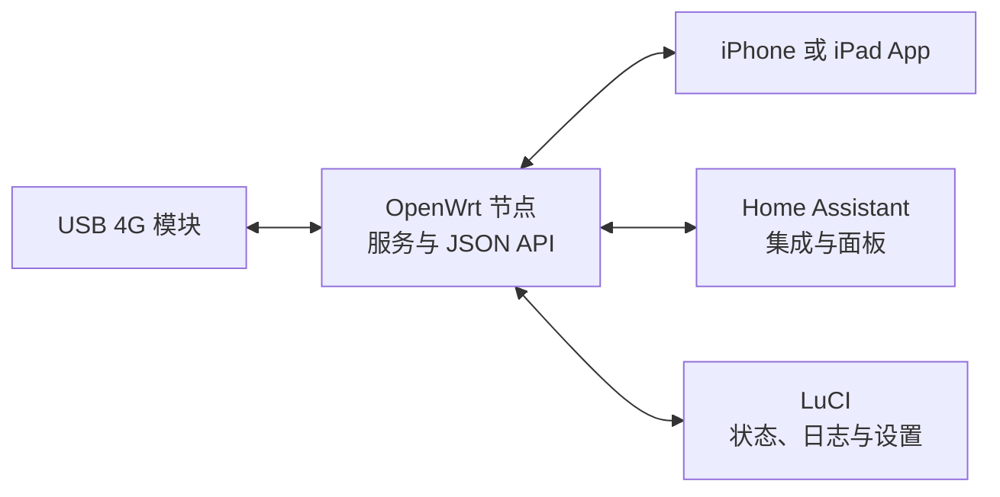
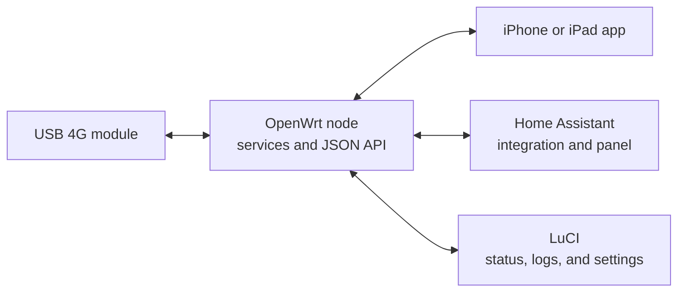

<a id="chinese-version"></a>
# SIM Anywhere

[English](#english-version) · [Apache License 2.0](./LICENSE) · [OpenAPI 规范](./OpenWrt/api/openapi.json)

**SIM Anywhere 将 USB 4G 模块与 OpenWrt、iOS 和 Home Assistant 连接起来，提供网络监控、短信、通话和流量管理能力。**

项目由运行在 OpenWrt 上的服务和 JSON API、LuCI 管理页面、iOS App，以及 Home Assistant 集成和侧边栏面板组成。



## 核心能力

- **连接监控：** 查看信号与网络注册信息、实时流量、历史记录、连接时长、模块温度和 USB 断连情况。
- **短信管理：** 归档收发短信，与模块同步短信，合并长短信，并支持阅读、标记、删除和发送。
- **语音通话：** 通过模块拨打和接听电话。iOS App 提供通话音频和 CallKit 集成；SIM、运营商及模块配置支持时，也可使用 Wi-Fi Calling。App 未运行时，来电唤醒尚未实现。
- **自动运营商发现：** VoWiFi 会尝试使用 SIM 和当前网络信息自动发现运营商参数；实际可用性仍取决于运营商是否提供标准发现记录及 VoWiFi 服务权限。
- **流量控制：** 设置周期流量和每日流量上限。OpenWrt 独立统计 USB 流量，并在达到已启用的限额后断开移动数据。
- **节点发现与管理：** iOS App 可在局域网发现节点；LuCI 可查看服务、日志、客户端、用量和设置。
- **Home Assistant 集成：** 提供模块和 SIM 设备，以及信号、温度、流量和网络传感器；也可在侧边栏显示节点监控页面。
- **代理控制（可选）：** OpenWrt 上集成兼容的 Clash 或 Mihomo 后，可查看代理组、测试延迟并切换代理。

## 当前支持

- **模块：目前仅支持 DJI 第一代 4G 模块（Baiwang QDC507）。**
- **OpenWrt：** 需要带 LuCI 的路由器。模块固件、运营商 IMS 配置会影响 Wi-Fi Calling 等功能。
- **iOS：** iOS 18 或更高版本；构建需要 Xcode 和 XcodeGen，项目使用 Swift 6。
- **Home Assistant：** 需要 Home Assistant。集成没有第三方 Python 依赖；侧边栏面板包目前声明支持 `aarch64`。

## 项目组件

| 路径 | 说明 |
| --- | --- |
| [`OpenWrt/`](./OpenWrt/) | OpenWrt 节点服务、模块 API、LuCI 包和监控页面 |
| [`OpenWrt/api/openapi.json`](./OpenWrt/api/openapi.json) | OpenAPI 3.1 接口规范 |
| [`App/`](./App/) | iPhone 和 iPad 使用的 SwiftUI App |
| [`HASS/custom_components/dongle_monitor/`](./HASS/custom_components/dongle_monitor/) | Home Assistant 集成和实体 |
| [`HASS/sim_anywhere/`](./HASS/sim_anywhere/) | Home Assistant 侧边栏面板包 |
| [`Graphs/`](./Graphs/) | 组件与数据流图 |

## 安装

本仓库提供面向代码代理的安装 Prompt。请在运行代理的环境中填写组件和目标设备信息：

```text
请从当前仓库为指定目标安装 SIM Anywhere 组件。

组件：[OpenWrt 节点 / iOS App / Home Assistant 集成 / Home Assistant 侧边栏面板]
目标平台和版本：[填写]
目标设备或主机：[填写，不要假设仓库中的示例地址适用于目标环境]
期望结果：[构建 / 安装 / 更新 / 验证]

开始前先阅读 README.md、所选组件的构建文件和源代码。检查目标当前版本和配置，再按组件提供的安装方法操作，并以当前仓库作为源代码。

保留现有配置和运行数据。不要打印、复制或提交密钥。除非我明确要求，不要发送短信、拨打电话、修改运营商或防火墙设置、将节点 API 暴露到公网，或重启路由器和模块。如果安装需要修改所选组件及其文档前置条件以外的内容，先说明具体改动并等待授权。

按文档构建或验证所选组件，然后部署并确认服务正常启动和响应。最后报告改动的文件或服务、执行的检查，以及仍需完成的设置。
```

## 安全与数据

OpenWrt API 会提供模块状态、设备标识、短信和通话数据。iOS App 默认通过局域网 HTTP 连接节点，通话还需要可访问的 WebSocket 端点。请将 API 限制在可信网络内；如需远程访问，请使用安全配置的 TLS 反向代理并限制访问对象。提交问题时不要附上未脱敏的模块标识、短信内容、通话记录或节点地址。

## 文档

- [OpenAPI 规范](./OpenWrt/api/openapi.json)
- [已知问题](./KNOWN-ISSUES.md)
- [系统组件图](./Graphs/simanywhere.md) · [OpenWrt 数据流](./Graphs/openwrt-dongle.md) · [Home Assistant 数据流](./Graphs/hass.md)

## 许可证

SIM Anywhere 使用 [Apache License 2.0](./LICENSE)。LuCI 包元数据使用相同许可证标识。第三方依赖仍遵循各自的许可证。

---

<a id="english-version"></a>
# SIM Anywhere (English)

[简体中文](#chinese-version) · [Apache License 2.0](./LICENSE) · [OpenAPI specification](./OpenWrt/api/openapi.json)

**SIM Anywhere connects a USB 4G module with OpenWrt, iOS, and Home Assistant for network monitoring, SMS, calls, and data usage control.**

The project includes services and a JSON API for OpenWrt, a LuCI administration page, an iOS app, and a Home Assistant integration with a sidebar panel.



## Core Features

- **Connection monitoring:** View signal and network registration, live traffic, history, connection uptime, module temperature, and USB disconnects.
- **SMS management:** Archive and sync messages with the module, combine multipart SMS, and read, mark, delete, or send messages.
- **Voice calls:** Place and receive calls through the module. The iOS app provides call audio and CallKit integration. Wi-Fi Calling is available when supported by the SIM, carrier, and module configuration. Incoming-call wake-up is not implemented while the app is not running.
- **Automatic carrier discovery:** Wi-Fi Calling attempts to discover carrier parameters from SIM and network information. Availability still depends on the carrier publishing standard discovery records and granting VoWiFi service.
- **Data usage control:** Configure cycle and daily limits. OpenWrt tracks USB traffic independently of app connections and disconnects mobile data when an enabled limit is reached.
- **Node discovery and administration:** Discover nodes on the LAN from the iOS app. Use LuCI to inspect services, logs, clients, usage, and settings.
- **Home Assistant integration:** Provide module and SIM devices with signal, temperature, traffic, and network sensors; show the node monitor page in the sidebar.
- **Optional proxy controls:** With a compatible Clash or Mihomo setup on OpenWrt, inspect proxy groups, test latency, and change selections.

## Current Support

- **Module: Currently, only the first-generation DJI 4G module (Baiwang QDC507) is supported.**
- **OpenWrt:** A router with LuCI is required. Module firmware and carrier IMS configuration affect features such as Wi-Fi Calling.
- **iOS:** iOS 18 or later. Building requires Xcode and XcodeGen; the project uses Swift 6.
- **Home Assistant:** A Home Assistant installation is required. The integration has no third-party Python dependencies. The sidebar panel package currently declares `aarch64` support.

## Components

| Path | Description |
| --- | --- |
| [`OpenWrt/`](./OpenWrt/) | OpenWrt node services, module API, LuCI package, and monitor page |
| [`OpenWrt/api/openapi.json`](./OpenWrt/api/openapi.json) | OpenAPI 3.1 specification |
| [`App/`](./App/) | SwiftUI app for iPhone and iPad |
| [`HASS/custom_components/dongle_monitor/`](./HASS/custom_components/dongle_monitor/) | Home Assistant integration and entities |
| [`HASS/sim_anywhere/`](./HASS/sim_anywhere/) | Home Assistant sidebar panel package |
| [`Graphs/`](./Graphs/) | Component and data-flow diagrams |

## Installation

This repository provides an agent-oriented installation prompt. Fill in the component and target details in the environment where the agent runs:

```text
Install the selected SIM Anywhere component from the current repository.

Component: [OpenWrt node / iOS app / Home Assistant integration / Home Assistant sidebar panel]
Target platform and version: [fill in]
Target device or host: [fill in; do not assume repository example addresses apply to the target]
Requested outcome: [build / install / update / verify]

First read README.md, the selected component's build files, and source code. Inspect the target's current version and configuration before changing anything. Follow the component's installation method and use this checkout as the source.

Preserve existing configuration and runtime data. Do not print, copy, or commit secrets. Do not send SMS, place calls, change carrier or firewall settings, expose the node API to the public Internet, or reboot the router or module unless I explicitly requested that action. If installation requires changes beyond the selected component and its documented prerequisites, explain the exact changes and wait for authorization.

Build or validate the selected component using its documented checks. Deploy it, confirm that it starts and responds as expected, then report changed files or services, checks performed, and remaining setup steps.
```

## Security and Data

The OpenWrt API serves module status, device identifiers, SMS, and call data. The iOS app connects to a node over HTTP on the local network by default; calls also require a reachable WebSocket endpoint. Keep the API on a trusted network. For remote access, use a securely configured TLS reverse proxy and restrict access. Do not publish unredacted module identifiers, SMS contents, call logs, or node addresses in issue reports.

## Documentation

- [OpenAPI specification](./OpenWrt/api/openapi.json)
- [Known issues](./KNOWN-ISSUES.md)
- [System component diagram](./Graphs/simanywhere.md) · [OpenWrt data flow](./Graphs/openwrt-dongle.md) · [Home Assistant data flow](./Graphs/hass.md)

## License

SIM Anywhere is licensed under the [Apache License, Version 2.0](./LICENSE). The LuCI package metadata uses the same license identifier. Third-party dependencies remain under their respective licenses.
